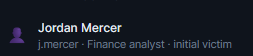
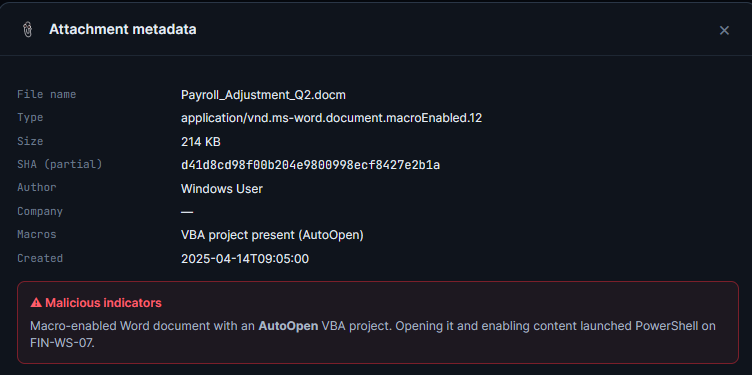
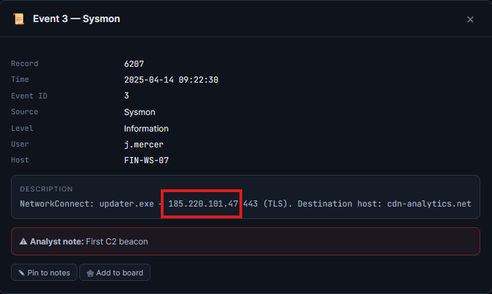
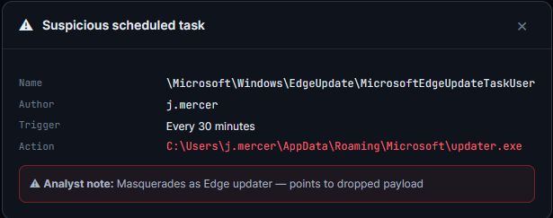
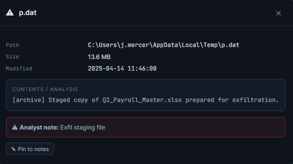
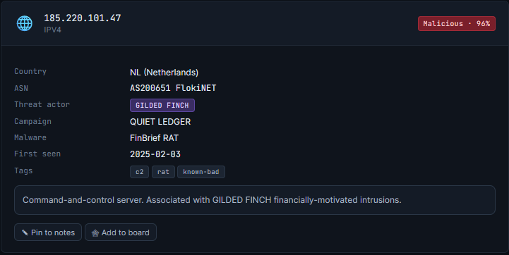

# Level 1: The Phantom Login — Forensic Analysis Write-Up

This write-up documents the investigation into the initial compromise, persistence mechanisms, exfiltration activity, and attribution associated with "The Phantom Login" incident scenario.

---

## 1. Which user account was the initial victim?

Initial review of the triage artifacts and case telemetry identifies the account belonging to user **j.mercer** as the entry point of the compromise.

**Answer:** `j.mercer`

---

## 2. What was the name of the malicious email attachment?

Auditing the email evidence locker for flagged and high-risk inbound messages reveals a weaponized Office document delivered directly to the victim's inbox.

**Answer:** `Payroll_Adjustment_Q2.docm`

---

## 3. What is the command-and-control (C2) IP address?

Filtering the security event logs by flagged activity isolates the initial outbound beaconing and C2 communications to an external IPv4 address.

**Answer:** `185.220.101.47`

---

## 4. What persistence mechanism was established? (name one)

Inspection of the host-level security event logs reveals two distinct persistence techniques established following code execution:
- **Registry Run Key:** `HKCU\Software\Microsoft\Windows\CurrentVersion\Run`
- **Scheduled Task Creation**

**Answer:** Registry Run Key (or Scheduled Task)

---

## 5. Which malware family / campaign was identified?

Analysis of the captured memory image using memory forensic modules identifies strings and behavioral signatures consistent with remote access trojan (RAT) tooling deployed on the endpoint.

**Answer:** RAT

---

## 6. What sensitive file was exfiltrated?

Examining file system snapshot artifacts identifies temporary staging activity at `C:\Users\j.mercer\AppData\Local\Temp\p.dat`. Parsing the staged container reveals that a proprietary financial spreadsheet was targeted and staged for outbound exfiltration.

**Answer:** `Q2_Payroll_Master.xlsx`

---

## 7. Which threat actor is attributed to this intrusion?

Correlating the observed file hashes, C2 network infrastructure, and behavioral heuristics against integrated threat intelligence telemetry attributes the campaign to known threat cluster **GILDED FINCH**.

**Answer:** GILDED FINCH

