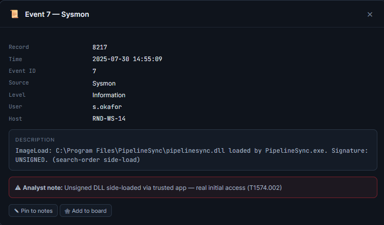
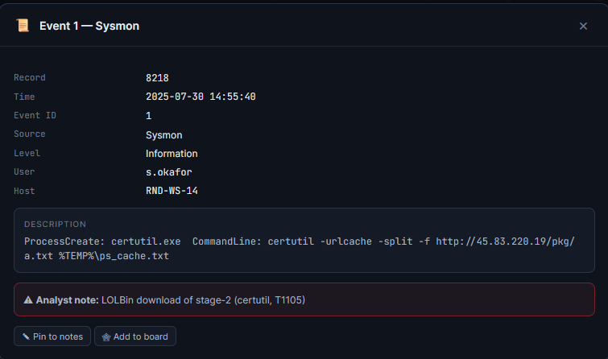
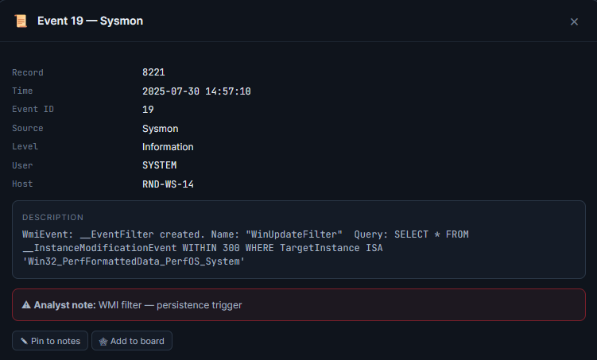
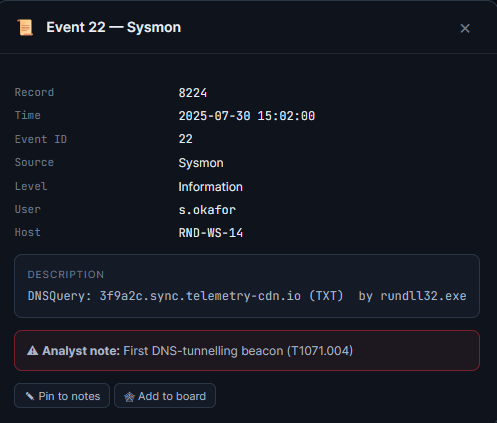
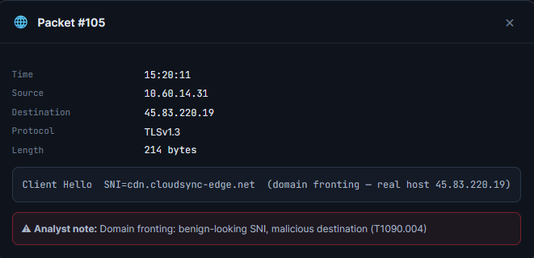
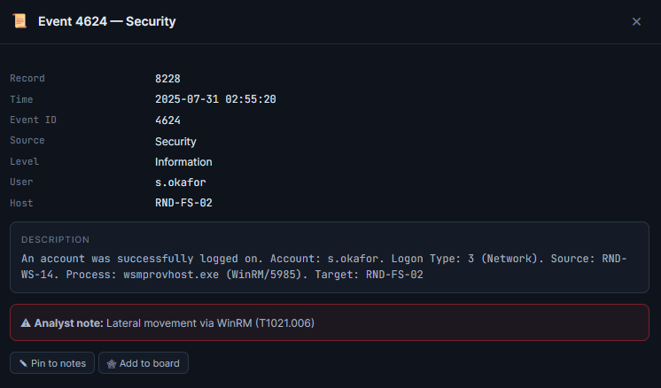
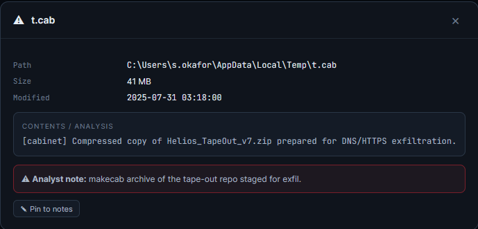
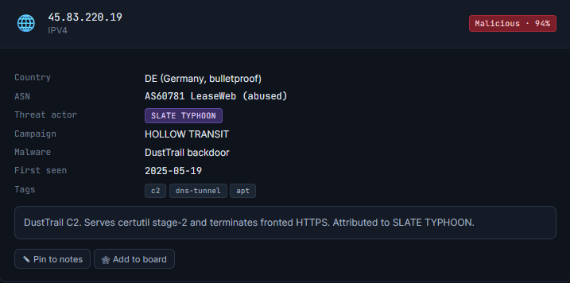

# Level 2: Hollow Transit — Forensic Analysis Write-Up

This write-up covers the investigation into the "Hollow Transit" advanced intrusion scenario, detailing patient-zero discovery, LOLBin abuse, persistence, network evasion, and threat actor attribution.

---

## 1. Which user account was the TRUE initial-access victim (patient zero)?

Reviewing the overarching case timeline and authentication logs isolates the primary account compromised at the perimeter prior to lateral traversal.

**Answer:** `s.okafor`

---

## 2. What was the initial-access vector?

Event log analysis identifies an unsigned, untrusted dynamic link library (DLL) executed via dynamic link library sideloading/proxy loading by an otherwise legitimate host executable.

**Answer:** Unsigned DLL (DLL Sideloading)

---

## 3. Which living-off-the-land binary (LOLBin) downloaded the second stage?

Examining process creation events shows the native Windows certificate utility being abused to retrieve remote secondary payloads directly to disk.

**Answer:** `certutil.exe`

---

## 4. What persistence technique was established?

Security auditing captures Windows Management Instrumentation (WMI) event subscriptions deployed on the endpoint, specifically leveraging an active **WMI event filter** bound to an event consumer.

**Answer:** WMI Event Filter (T1546.003)

---

## 5. What domain was used for DNS-tunnelling C2?

Network inspection reveals high-frequency, anomalous DNS query lengths utilized for covert data encapsulation and C2 communications.

**Answer:** `3f9a2c.sync.telemetry-cdn.io`

---

## 6. What is the C2 IP address?

Correlating the captured network flows reveals the resolved C2 IP address receiving encapsulated communications.

**Answer:** `45.83.220.19`

---

## 7. Which technique was used for lateral movement?

Review of Windows event telemetry identifies successful remote process instantiation and protocol binding via Windows Remote Management.

**Answer:** WinRM (Windows Remote Management)

---

## 8. What intellectual property was exfiltrated?

Forensic inspection of the staging path `C:\Users\s.okafor\AppData\Local\Temp\t.cab` confirms the adversary compressed and packaged proprietary semiconductor design files for extraction.

**Answer:** Tape-out archive

---

## 9. The insider d.raymond looks suspicious. Are they responsible for the intrusion? (yes / no)

Correlating endpoint execution logs and network telemetry confirms that `d.raymond` was not the vector or operator behind this intrusion sequence.

**Answer:** No

---

## 10. Which threat actor is attributed to this intrusion?

Threat intelligence correlation against the DNS tunneling infrastructure, WMI persistence tradecraft, and specialized payload signatures links this intrusion to the adversary group **SLATE TYPHOON**.

**Answer:** SLATE TYPHOON

