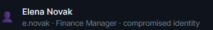
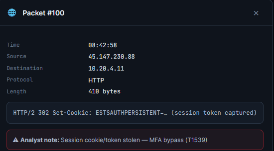
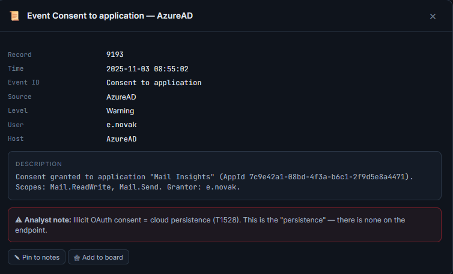
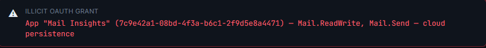
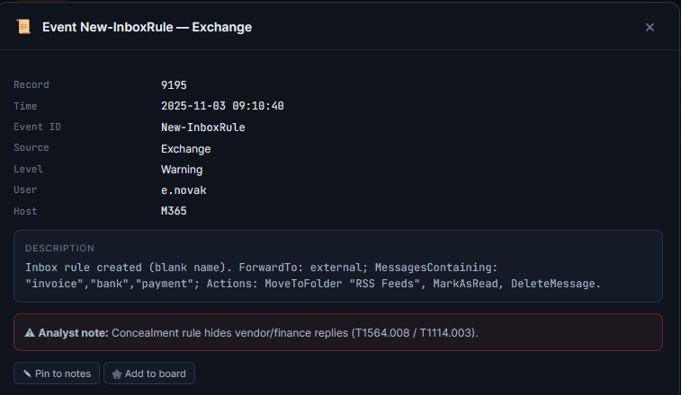
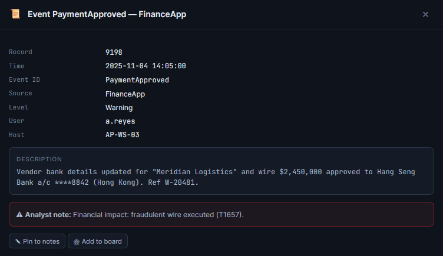
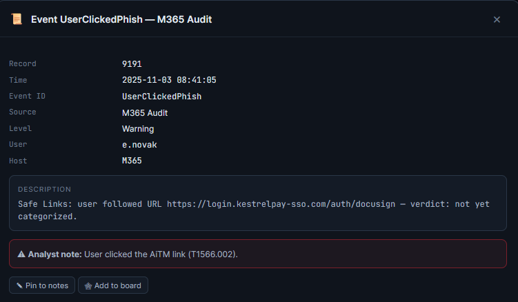
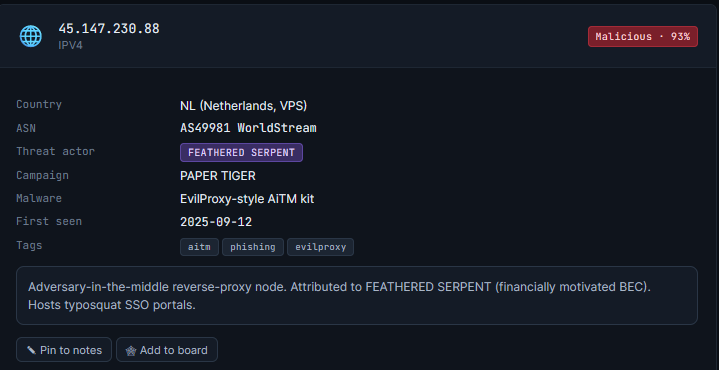

# Level 3: Glasshouse — Forensic Analysis Write-Up

This write-up provides a detailed forensic analysis of the "Glasshouse" cloud identity compromise, analyzing Adversary-in-the-Middle (AiTM) MFA bypass, illicit OAuth tenant persistence, and subsequent Business Email Compromise (BEC) wire-transfer fraud.

---

## 1. Which user identity was compromised (patient zero)?

Audit log review of anomalous cloud directory authentication requests pinpoints the initial victim account.

**Answer:** `e.novak`



---

## 2. What technique bypassed MFA during initial access?

The threat actor deployed an Adversary-in-the-Middle (AiTM) reverse proxy architecture to intercept legitimate session cookies/tokens during real-time authentication, circumventing downstream multi-factor challenges.

**Answer:** AiTM Session Cookie / Token Hijacking



---

## 3. What provided persistence in the cloud identity plane?

Tenant audit records show that the adversary utilized the hijacked session to register and grant consent to a rogue cloud application, establishing persistent API-level access independent of future user password changes.

**Answer:** Illicit OAuth Consent Grant (App Registration)



---

## 4. Which app permission scopes were abused for mailbox access + BEC?

Token telemetry and app registration audits confirm the granting of high-privilege Microsoft Graph API mail scopes:

- `Mail.ReadWrite`
- `Mail.Send`

**Answer:** `Mail.ReadWrite` and `Mail.Send`



---

## 5. What mailbox rule did the attacker use to conceal the fraud?

Mailbox audit logs confirm the creation of an evasive forwarding and deletion rule configured with no display name:

```text
ForwardTo: external
MessagesContaining: "invoice", "bank", "payment"
Actions: MoveToFolder "RSS Feeds", MarkAsRead, DeleteMessage
```

**Answer:** Inbox rule redirecting and hiding financial communications (Forward to external; Keywords: "invoice", "bank", "payment"; Move to "RSS Feeds", Mark as Read, Delete)



---

## 6. What was the ultimate fraudulent action (impact)?

The adversary leveraged their illicit mailbox access to intercept vendor email threads, alter banking instructions, and execute unauthorized payment diversion via wire transfer.

**Answer:** Fraudulent wire transfer / Payment diversion



---

## 7. Which vendor was impersonated in the payment-redirect fraud?

Financial records and compromised correspondence confirm the threat actor targeted and impersonated legitimate supply chain partner **Meridian Logistics**.

**Answer:** Meridian Logistics


---

## 8. What is the AiTM phishing / proxy domain used for initial access?

DNS and proxy inspection logs track the upstream reverse-proxy endpoint mimicking the corporate single sign-on interface.

**Answer:** `login.kestrelpay-sso.com`



---

## 9. From which country did the malicious sign-in originate?

Geolocation metadata tied to the adversary's proxy egress IP address maps back to infrastructure hosted in the Netherlands.

**Answer:** The Netherlands



---

## 10. The DBA d/p.hollis exported a customer database. Is that part of THIS intrusion? (yes / no)

Forensic correlation confirms the scope of this attack is strictly isolated to identity-plane manipulation and wire fraud targeting `e.novak`. The database export activity does not share IOCs or campaign objectives with this breach.

**Answer:** No

---

## 11. Logs contain a user-agent implicating "CRIMSON JACKAL". Should you attribute to them? (yes / no)

No. Threat intelligence mapping indicates this user-agent was an intentional false flag or an artifact of concurrent unrelated background noise, which conflicts directly with the corroborated infrastructure and TTPs of the primary attacker.

**Answer:** No

---

## 12. Which threat actor is ACTUALLY responsible?

Correlating the AiTM infrastructure, specific illicit OAuth workflows, and target industry heuristics attributes the intrusion directly to **FEATHERED SERPENT**.

**Answer:** FEATHERED SERPENT


